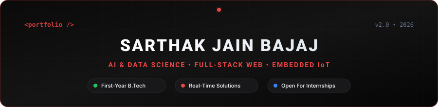
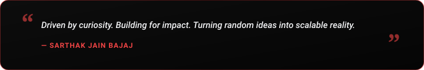

  

  

  
  &nbsp;
  
  &nbsp;
  
  &nbsp;
  
  &nbsp;
  

  

<h2 align="center"> About Me</h2>

  

  

  Hey! I'm <b>Sarthak Jain Bajaj</b>, a passionate <b>Artificial Intelligence & Data Science student and developer</b> based in India. 
  I specialize in architecting scalable web applications, real-time data solutions, and integrating AI/ML models with IoT & embedded systems. Actively seeking internship opportunities to apply my technical and problem-solving skills in real-world environments.

  
  &nbsp;
  
  &nbsp;
  

  <b>Let's Discuss:</b> Python, C++, Java, JavaScript, Next.js, Embedded Systems, Machine Learning & Git Workflows. 
  <b>Philosophy:</b> <i>"I love turning curiosity into scalable code and late-night ideas into reality!"</i>

<table width="100%" border="0" align="center">
  <tr>
    <td width="50%" align="center" style="padding: 14px;">
      <h4> Academics & Goal</h4>
      
<b>B.Tech in AI & Data Science</b> Seeking Internships & Impactful Roles

    </td>
    <td width="50%" align="center" style="padding: 14px;">
      <h4> Active Deep Dives</h4>
      
<b>DSA & Problem Solving</b> Next.js, Machine Learning & Systems

    </td>
  </tr>
  <tr>
    <td width="50%" align="center" style="padding: 14px;">
      <h4> Tech & Insights</h4>
      
<a href="https://instagram.com/sarthak.bajaj__" target="_blank"><b>@sarthak.bajaj__</b></a> Updates, AI & Tech Content

    </td>
    <td width="50%" align="center" style="padding: 14px;">
      <h4> Collaboration</h4>
      
<b>AI, Web & IoT Systems</b> Open to exciting new projects

    </td>
  </tr>
</table>

<h2 align="center"> Tech Stack & Skills</h2>

<b>Core Programming Languages</b>

  

<b>Frontend & UI Development</b>

  

<b>Backend, Databases & Cloud</b>

  

<b>AI, Embedded IoT, Tools & Systems</b>

  

  
  &nbsp;
  
  &nbsp;
  
  &nbsp;
  

<h2 align="center"> GitHub Analytics & Activity</h2>

  
  &nbsp;&nbsp;
  

  

  

<h2 align="center"> Contribution Journey</h2>

  

<h2 align="center"> Let's Connect & Collaborate</h2>

<i>Whether you want to discuss AI systems, explore open-source collaboration, or just say hello — my inbox is always open!</i>

<table border="0" align="center">
  <tr>
    <td align="center" width="220" style="padding: 16px;">
      <a href="https://linkedin.com/in/sarthak-jain-bajaj" target="_blank">
          
        
      </a> 
      <b>Professional Network</b>
    </td>
    <td align="center" width="220" style="padding: 16px;">
      <a href="https://instagram.com/sarthak.bajaj__" target="_blank">
          
        
      </a> 
      <b>Updates & Insights</b>
    </td>
    <td align="center" width="220" style="padding: 16px;">
      <a href="mailto:sarthakjainbajaj@gmail.com">
          
        
      </a> 
      <b>Direct Contact</b>
    </td>
  </tr>
</table>

  

